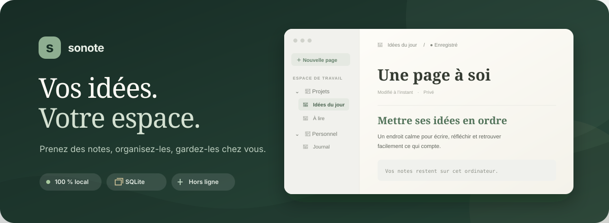

<p align="center">
  
</p>

<p align="center">
  <strong>Un espace de notes personnel, simple et local.</strong><br>
  Organisez vos idées dans une interface inspirée des outils modernes de prise de notes,
  tout en gardant vos données sur votre ordinateur.
</p>

<p align="center">
  <a href="#fonctionnalites">Fonctionnalités</a> ·
  <a href="#installation">Installation</a> ·
  <a href="#donnees-et-confidentialite">Données et confidentialité</a>
</p>

## À propos

**SoNote** est une application de prise de notes hors ligne, construite avec Python, Flask, SQLite et du JavaScript sans framework. Elle démarre un petit serveur sur votre ordinateur et ouvre l’application dans votre navigateur. Aucun compte ni service en ligne n’est nécessaire.

## Fonctionnalités

- **Notes et dossiers** : créez des pages à la racine ou dans un dossier, ajoutez des sous-dossiers et repliez l’arborescence.
- **Déplacement** : glissez une note sur un dossier ou utilisez les options de déplacement pour les notes et les dossiers.
- **Éditeur par blocs** : paragraphes, titres, listes, tâches, citations, code et séparateurs. Le menu `/` permet de choisir un type de bloc.
- **Mise en forme** : gras, italique, souligné, barré, liens et raccourcis clavier.
- **Sauvegarde automatique** : les changements sont enregistrés dans la base locale SQLite.
- **Recherche et favoris** : retrouvez une note par son titre ou son contenu, et épinglez vos pages favorites.
- **Corbeille** : restaurez les pages et dossiers supprimés, supprimez des éléments définitivement ou videz toute la corbeille.
- **Personnalisation** : thèmes clair et sombre, barre latérale repliable et nom d’espace personnalisable.
- **Export** : exportez une page en Markdown.

### Raccourcis

| Action | Raccourci |
|---|---|
| Rechercher | `Ctrl+K` ou `⌘+K` |
| Nouvelle page | `Ctrl+N` ou `⌘+N` |
| Gras | `Ctrl+B` ou `⌘+B` |
| Italique | `Ctrl+I` ou `⌘+I` |
| Choisir un bloc | Tapez `/` dans un bloc vide |

## Installation

### Prérequis

- Python **3.10 ou plus récent**
- Un navigateur web récent

Clonez le dépôt et ouvrez le dossier du projet :

```bash
git clone https://github.com/c0dexio/SoNote.git
cd SoNote
```

Créez un environnement Python et installez la dépendance :

**Windows — PowerShell**

```powershell
py -m venv .venv
.venv\Scripts\Activate.ps1
python -m pip install -r requirements.txt
```

**macOS ou Linux**

```bash
python3 -m venv .venv
source .venv/bin/activate
python -m pip install -r requirements.txt
```

## Lancer SoNote

Dans le dossier du projet, avec l’environnement virtuel activé :

```bash
python main.py
```

Le navigateur s’ouvre sur [http://127.0.0.1:5000](http://127.0.0.1:5000). Pour arrêter le serveur, revenez au terminal et appuyez sur `Ctrl+C`.

## Données et confidentialité

SoNote écoute uniquement sur `127.0.0.1` : l’application est accessible depuis votre ordinateur et n’expose pas le serveur sur le réseau local. Les notes sont enregistrées dans `data/sonote.db`. L’application n’envoie pas vos notes vers un serveur externe et les fichiers de l’interface ne dépendent pas d’un CDN.

Le dossier `data/` est ignoré par Git pour éviter de publier vos notes avec le code. Pour sauvegarder vos données, arrêtez SoNote puis copiez ce dossier dans un emplacement sûr. Ne supprimez pas `data/sonote.db` si vous souhaitez conserver vos notes.

## Structure du projet

```text
SoNote/
├── main.py                 # Démarrage du serveur local
├── requirements.txt        # Dépendances Python
├── sonote/                 # Application Flask, API et SQLite
├── templates/              # Page principale
├── static/                 # Styles et JavaScript de l’interface
├── docs/                   # Visuels du README
└── data/                   # Base locale créée au premier lancement
```

## Périmètre actuel

SoNote est en développement. L’export Markdown est disponible ; l’import de fichiers, l’export PDF/HTML, les images et les tableaux ne sont pas encore implémentés. L’application ne comporte pas de comptes utilisateurs ni de synchronisation entre appareils.

## Technologies

Python · Flask · SQLite (bibliothèque standard) · HTML · CSS · JavaScript
